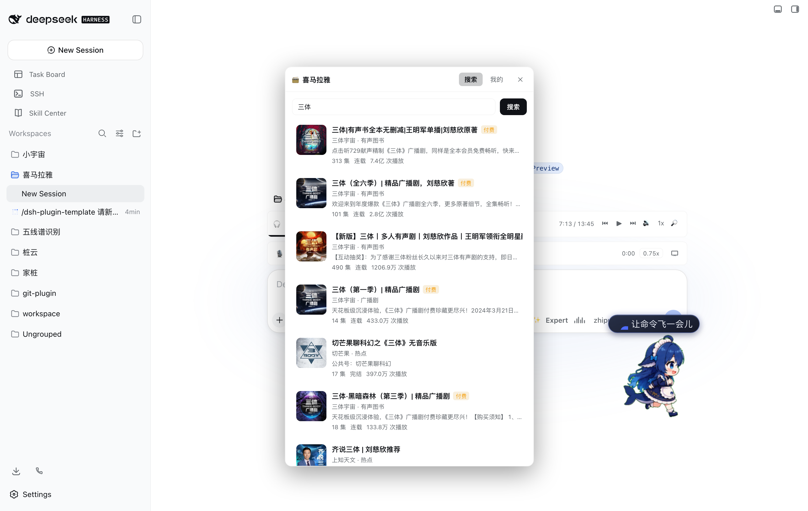
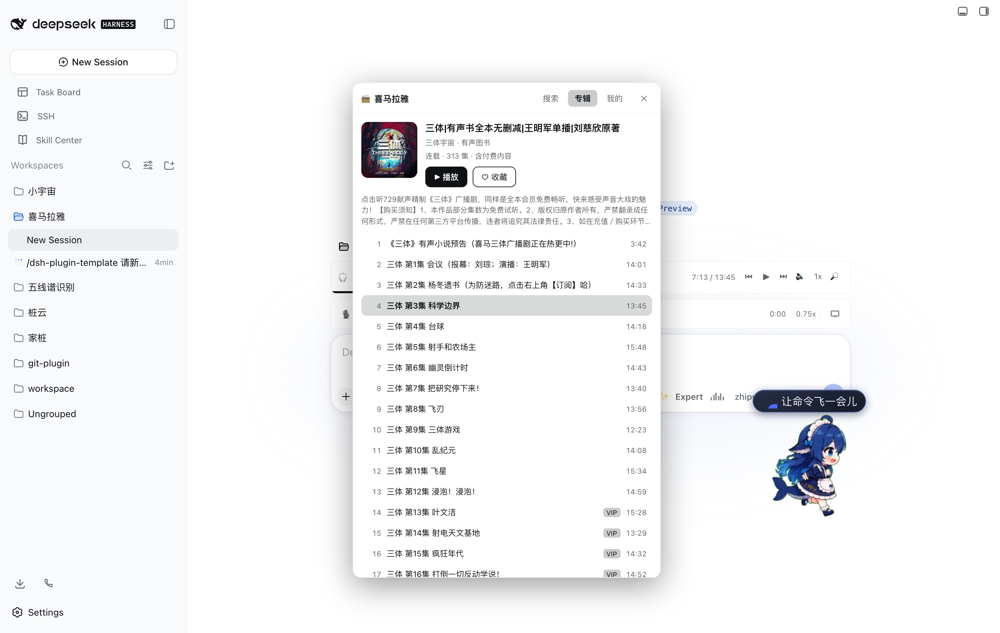
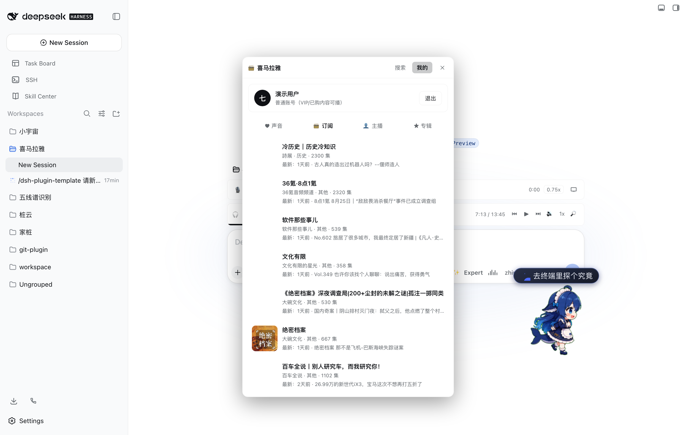
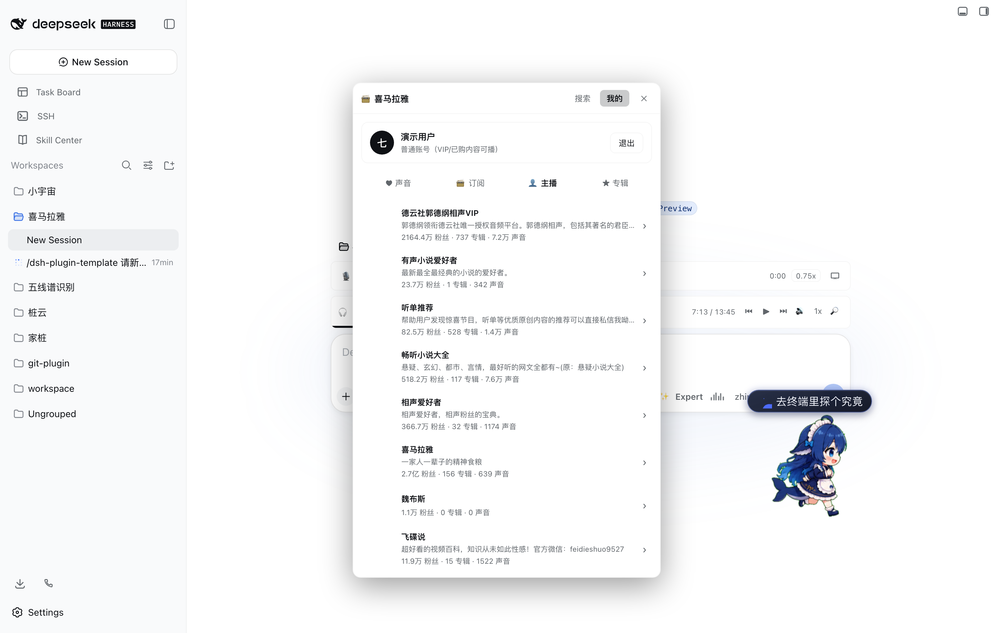

# dsh-tingbar

> **听说播放器 / TingBar** —— DeepSeek Harness 听说播放器插件：**喜马拉雅 + 懒人听书**双平台。

在 DSH 的 Web 界面里直接**收听喜马拉雅与懒人听书**：搜索专辑/播客/有声书、浏览曲目列表、一键播放，左侧栏底部常驻播放条（播放/暂停/上一集/下一集/快进/快退/进度拖动/音量/倍速；侧栏折叠成竖条时退化为一个 ▶/⏸ 图标按钮）。面板头部有平台切换器，两个平台各自独立登录（扫码）、各自的收藏与断点续播。还注册了 `ximalaya_play` 模型工具——直接在对话框里说「播放三体」「来点郭德纲相声」，节目就响起来；说「播放懒人听书里的史上第一混乱」也会自动切到对应平台。

> ⚠️ 两个平台都是**非官方接口**，仅供个人学习/试听（见文末声明）。懒人听书的搜索与收听接口强制登录，需先扫码。

## 来源与改动

本项目**来源于** [`jerryqx/dsh-ximalaya`](https://github.com/jerryqx/dsh-ximalaya)（喜马拉雅单平台插件，作者 jerryqx，MIT License）。在它基础上做了大规模扩展，形成这个双平台独立项目。

**主要改动与新增功能**：

- **双平台**：在喜马拉雅之外，完整逆向并接入「懒人听书 / 懒人畅听」（TME 旗下）：扫码登录（`webQrCreate`/`webQrStatus` + 本地生成二维码）、书籍详情、目录、播放地址解析（`getListenPath` 需 `tmeId`）、收听历史、云端收藏。
- **平台切换器**：面板头部一键切换「喜马拉雅 / 懒人听书」，登录态、收藏、断点续播各自独立。
- **热搜与分类榜单**：喜马拉雅 19 个一级分类两级下拉（每榜 Top100）；懒人听书按「分组 → 榜单」两级选择（全部/出版/儿童/节目，29 张榜 Top100）。
- **会员状态识别**：两平台会员字段口径完全不同（喜马拉雅 `vipExpireTime` 是剩余天数、懒人听书根本没有 `isVip` 字段），Host 端统一归一化为 `isVip/vipLevel/vipDays/vipUntil`，面板显示 VIP 徽标与到期日。
- **真实头像**：修复了头像字段（喜马拉雅 `logoPic` / 懒人听书 `cover`），登录后显示真实头像。
- **云端历史 / 收藏**：收听历史直接读账号云端数据（喜马拉雅「听过」、懒人听书「收听记录」），和手机 App 是同一份。
- **断点续播（含章节序号）**：当前专辑/曲目/进度/章节序号持久化，刷新页面自动恢复。
- **播放条重构**：从输入框上方迁到左侧栏底部（设置/导入入口上方），折叠态退化单图标；封面、音量内联、倍速、快进/快退、进度拖动。
- **快进/快退修复（回环 http 源）**：宿主页面在 `dsh-app://` 自定义协议下 `<audio>` 不可 seek，改为走 Host 起在 127.0.0.1 随机端口的回环 http 源后恢复。
- **自动连播修复**：刷新/历史续播后不再丢专辑目录上下文，一集播完能自动切下一集。
- **测试**：从 56 用例扩到 155 用例（协议 mock + 路由 + Web 渲染冒烟），CI 全绿。

> 详细研究记录见 [`docs/feasibility-report.md`](docs/feasibility-report.md)（协议逆向、接口探测、迭代记录）。

## 界面预览

| 搜索专辑 | 专辑详情 |
|---|---|
|  |  |

| 我的订阅 | 关注的主播 |
|---|---|
|  |  |

## 特性

- **双平台**：面板头部一键切换「喜马拉雅 / 懒人听书」，两个平台各自独立登录态、独立收藏、独立断点续播；侧栏播放条文案跟着当前平台变
- **搜索**：按关键词搜专辑/书籍（封面/主播或播讲人/分类/集数/完结状态/播放量卡片式展示），带搜索历史
- **热搜与分类榜单**：搜索页空态显示「🔥 大家都在搜」的 10 个热搜词（点即搜，仅喜马拉雅）；点「📈 榜单」展开**分类榜单**——喜马拉雅按「一级分类（小说/相声评书/儿童/有声图书/人文国学/历史/悬疑…共 19 类）→ 子榜单」两级下拉选榜，每榜 **Top100**；懒人听书按「分组（全部/出版/儿童/节目）→ 榜单」两级选择，覆盖全部书籍/专辑榜，每榜 **Top100**。点专辑卡片进详情收听
- **专辑浏览**：曲目列表**滚到底部自动加载下一批 30 集**（也可点「加载更多」手动触发），自动按 id 去重；懒人听书服务端不分页（忽略 `pageNo`、单次上限 1000 条），因此改为「一次取满 + 本地切片 + 10 分钟缓存」，翻页不再重复第一页
- **收听历史（两平台都有，云端同一份）**：「我的」页第一段就是「🕘 历史」，读的是**账号里的历史**——喜马拉雅的「听过」（`getListened`）、懒人听书的「收听记录」（`getRecentListenBooks`）。显示「听到 mm:ss / 总时长（n%）· 2天前」，点一条即从上次位置续播
- **云端收藏（懒人听书）**：「我的 → ★ 收藏」直接读懒人听书账号的收藏书架（`getCollectionBooks`），点卡片进书籍；右上角 **↻ 刷新** 一键拉新
- **收藏的声音**（喜马拉雅）：「我的」页展示账号收藏（♥ 喜欢）的声音列表，分页加载、**点击即播**
- **我的订阅**（喜马拉雅）：展示账号订阅的专辑（含「最新：x天前 · 最新一集」更新提示）
- **关注的主播**（喜马拉雅）：展示已关注主播（头像/简介/粉丝数/专辑数）
- **播放条**（左侧栏底部）：播放/暂停、上一集/下一集（自动连播专辑列表，翻页自动续）、**快进/快退**（默认步长 15 秒，右键 ⏪/⏩ 可选 5/10/15/30/60 秒步长）、可拖进度条、音量、倍速（0.75x–2x）、时间显示
- **云端同步（两平台）**：收听历史与收藏都读账号云端数据；喜马拉雅的订阅/收藏/关注还能反向写回 App
- **音频流代理**：播放地址由 Host 端解析并流式转发（支持 Range 拖动/续传），浏览器无 CORS 顾虑，登录态（含 cookie）不出 Host
- **扫码登录（两平台各自独立）**：喜马拉雅 App / 懒人听书 App 扫码后落盘 cookie；喜马拉雅免费内容无需登录，VIP/已购内容需登录且账号有权限；懒人听书连免费章节都要登录
- **会员状态识别（两平台）**：「我的」页头像旁显示 `VIP` / `VIP Lv5` 徽标，下面一行写明「会员生效中 · 剩 N 天 · YYYY-MM-DD 到期」
- **收藏**：专辑一键收藏（♥），收藏按平台分开存，跨刷新/重启保留
- **断点续播**：当前专辑/曲目/进度（懒人听书还含章节序号 `section`）持久化在 Host 端，刷新页面自动恢复
- **`ximalaya_play` 模型工具**：可按关键词搜索播放（`query`），或直接指定 `albumId`/`trackId`，新增 `platform` 参数（`ximalaya` / `lrts`）；支持 `action` 暂停/继续/停止/下一集/上一集
- 免登录可播喜马拉雅全部免费专辑；付费/VIP 专辑在登录且账号有权限时可播

## 安装

需要已安装 `dsh` CLI（Node ≥ 20）。macOS / Linux / Windows 均可。

从 GitHub 安装：

```sh
# 1. 克隆仓库
git clone https://github.com/fyxsky/dsh-tingbar.git
cd dsh-tingbar
npm install

# 2. 安装到 profile（把 <profile> 换成实际 profile 名，如 web）
dsh plugin --profile <profile> add /path/to/dsh-tingbar
```

或先打包成 tarball 再安装：

```sh
cd dsh-tingbar
npm install
npm pack                       # 生成 dsh-tingbar-0.1.0.tgz
dsh plugin --profile <profile> add ./dsh-tingbar-0.1.0.tgz
```

安装后重启 `dsh web` 并刷新页面：

- 左侧栏底部（设置按钮上方）出现播放条；展开侧栏可看到完整控制键
- 点播放条里的 **🔎** 打开面板，面板头部可切换「喜马拉雅 / 懒人听书」
- 搜索并点专辑即可收听；懒人听书需先在「我的」页扫码登录
- 直接对 agent 说「播放三体」也能播

> **macOS 提示**：本插件没有 Windows 特有路径或脚本——状态文件写在 `~/.dsh/tingbar-state.json`（跨平台），回环音频源监听 `127.0.0.1` 随机端口，安装/运行逻辑完全平台无关。若 macOS 首次运行提示端口被拒，确认没有防火墙拦截 `127.0.0.1` 回环流量即可。

## 使用

1. **切换平台**：面板头部两个按钮「喜马拉雅 / 懒人听书」，带 `●` 表示该平台已登录。切换会停止当前播放并清空面板里的搜索/专辑状态（登录态、收藏、断点续播各自保留）。选择会持久化到 Host 端，刷新后仍是你上次选的平台
2. **搜索播放**：面板「搜索」页输入关键词（如「三体」「郭德纲」「晓说」）→ 点专辑卡片 → 点任意曲目（或专辑头部的「▶ 播放」）。懒人听书未登录时搜索页会显示「需要登录」卡片，点「去扫码登录」跳到「我的」页
3. **连续播放**：一集播完自动播下一集；⏮/⏭ 在专辑内切换。当前曲目不在已加载的目录分页里时，Host 会去完整目录里定位相邻章节——`GET /dsh-tingbar/neighbor`
4. **让 agent 播放**：对话框里说「用喜马拉雅播放 XXX」/「播放懒人听书里的 XXX」；agent 会调用 `ximalaya_play` 工具（带 `platform` 参数），播放条 2 秒内响应，必要时自动切平台
5. **VIP/付费内容**：面板「我的」页 → 对应平台 App 扫码登录 → 已购/VIP 内容自动解锁（喜马拉雅播放质量也会升到 128k M4A）。懒人听书**所有章节**都要登录才有播放地址
6. **收听历史（两平台，账号云端那份）**：「我的」页默认落在「🕘 历史」，直接读你账号里的历史。显示「听到 mm:ss / 总时长（n%）· 2天前」，点一条从上次位置续播。**需要先扫码登录**；点 ↻ 刷新拉最新
7. **收藏的声音 / 我的订阅 / 关注的主播**（喜马拉雅）：「我的」页分段「🕘 历史 / ♥ 声音 / 📻 订阅 / 👤 主播 / ★ 专辑」。懒人听书「我的」页是「🕘 历史 / ★ 收藏」
8. **刷新按钮**：「我的」页分段行右侧有 **↻ 刷新**，按当前分段强制重新拉取
9. **倍速/音量/快进快退**：播放条上点 `1.0x` 循环切换倍速；🔊 静音/取消静音（音量条常驻右侧内联）；⏪/⏩ 按步长快退/快进（默认 15 秒），**右键**这两个按钮可改步长
10. **云端同步（需登录，仅喜马拉雅）**：专辑页「📻 订阅」按钮订阅/退订专辑；「我的」页每条收藏声音右侧 ✕ 取消收藏、每张订阅专辑「退订」、每位关注主播「取关」
11. **面板不遮挡输入区**：面板位置与高度自动钳制，播放控制常驻左侧栏底部

> 目录加载：专辑页滚到底部会自动追加下一批 30 集（也保留「加载更多」按钮兜底）。懒人听书对超过 1000 章的书籍只能拿到前 1000 章（对端接口单次上限），此时列表底部会给出说明。

> 说明：喜马拉雅的「声音 / 订阅 / 主播」三段读取的是账号云端数据（需先扫码登录）；「★ 专辑」是插件本地的收藏（仅存本机，按平台分开存）。

## 配置

插件为「Host 端 + Web 端」双面结构：

- **Host 端**（`lib/index.js`）：按平台分发到 `lib/providers/*`，做接口代理（搜索/专辑/目录/扫码登录/收藏/订阅/关注）、播放地址解析与音频流转发、`ximalaya_play` 工具、状态持久化
- **Provider 层**（`lib/providers/ximalaya.js`、`lib/providers/lrts.js`、`lib/providers/index.js`）：把两个平台统一成一套契约（`qrCreate/qrCheck/user/search/album/tracks/resolvePlay/streamHeaders/errorInfo` + 能力矩阵 `needsLogin`/`supports`），Host 与 Web 端都只认契约
- **Web 端**（`lib/client.js`）：浏览器里的播放条 + 面板（搜索/专辑/主播/我的）+ 平台切换器

由 `cordis.patch.yml` 插入 `tingbar-player` 行自动组对：

```yaml
- insert:
    - id: tingbar-player
      name: 'dsh-tingbar'
```

**状态持久化**：登录态（两平台各自 cookie + 用户信息）、收藏（分平台）、搜索历史、音量/倍速、面板位置、上次播放（专辑/曲目/进度/章节序号）全部保存在 Host 端 `~/.dsh/tingbar-state.json`（结构 `version: 2`，旧版扁平结构会自动迁移到喜马拉雅槽位），重启/刷新不丢。

## 开发

```sh
npm install
npm test        # vitest：xmly 纯函数 + lrts provider（mock fetch）+ provider 契约 + host 路由 + Web 渲染冒烟（155 用例）
```

修改 `lib/` 后本地调试：

```sh
dsh plugin --profile <profile> add ./   # 或直接改 profile 里的 link 目标
```

结构：

```text
lib/
├── xmly.js              # 喜马拉雅 API 库：搜索/专辑/曲目/播放地址（xm-sign 签名 + 解密）/扫码登录/收藏/订阅/关注
├── providers/
│   ├── index.js         # 平台注册表 + 契约文档（PROVIDERS / PLATFORM_IDS / providerOf / platformsMeta）
│   ├── ximalaya.js      # 喜马拉雅 provider：把 xmly.js 适配成统一契约
│   └── lrts.js          # 懒人听书 provider：扫码登录（webQrCreate/webQrStatus + 本地生成二维码）、目录、getListenPath
├── index.js             # Host 半边：/dsh-tingbar/* 路由（带 ?platform=）、音频流代理、ximalaya_play 工具
└── client.js            # 浏览器半边：播放条 + 面板 + 平台切换（slots 注入）
```

## 使用声明（重要）

本插件通过**非官方接口**访问喜马拉雅与懒人听书内容，所播放内容的版权归各平台及权利方所有。仅供**个人学习、技术研究、日常试听**使用，严禁用于任何商业用途、公开传播、二次分发或盈利行为。扫码登录产生的账号风控、封禁等风险由使用者自行承担。如您不同意以上条款，请勿使用本插件。

## 常见问题

**播放条显示「浏览器拦截了自动播放」？**
浏览器安全策略禁止未交互的音频播放。首次自动播放被拦截是正常的——在播放条上点一次 ▶ 即可解锁，之后恢复自动播放。

**某些曲目提示「需要登录或已购/VIP 权限」？**
该曲目是付费/VIP 内容。面板「我的」页扫码登录；若账号未购买该专辑或非 VIP，则无法播放（这是平台版权限制，插件不会绕过付费墙）。

**懒人听书为什么不登录什么都听不了？**
懒人听书的网页端播放器在下发播放地址前强制校验登录态（实测未登录调 `/api/gateway/getListenPath` 直接返回「需要登录才能继续使用此功能」），免费章节也一样——这是对端产品设计，不是插件限制。搜索接口同样强制登录。喜马拉雅则是免费内容免登录可播。

**懒人听书能订阅 / 收藏 / 关注主播吗？**
能看收藏、不能订阅/关注。它的网页端暴露了「收藏的书架」（`getCollectionBooks`），所以「我的 → ★ 收藏」会列出你账号里收藏的书；但订阅/关注/点赞的接口没有对网页端开放，因此这三段只在喜马拉雅下出现。

**我在懒人听书 App 里新收藏了一本，插件里看不到？**
「★ 收藏」是一次性拉取的快照，不会自动轮询。点「我的」页右上角的 **↻ 刷新** 即可拉新。

**「加载更多」为什么以前总显示第一页？**
已修。懒人听书的 `/api/book/resource` 会**忽略 `pageNo`/`start`/`offset` 等一切分页参数**（单次上限 1000 条），所以旧版按页请求必然重复第一页。现在改为「一次取满 1000 条 + Host 端本地切片 + 10 分钟缓存」，并配合前端滚到底部自动加载、按 id 去重。

**收听历史存在哪？会和手机同步吗？**
会。历史直接读**你账号里的那一份**：喜马拉雅读「听过」（`/revision/my/getListened`），懒人听书读「收听记录」（`/api/collection/getRecentListenBooks`）。前提是先扫码登录。

**切换平台后播放停了？**
这是设计行为：切换平台会暂停并释放当前音频，避免两个平台的音频流互相抢控制器。当前进度已存 Host 端，切回去点 ▶ 可续听。

**懒人听书的 VIP 内容还是播不了？**
确认该账号在懒人听书 App 里确实有效（VIP 或已购买该书）。插件只转发登录态 cookie，权限由服务端判定；登录后仍然 `path` 为空即账号无该内容权限。

**「我的」页为什么一直显示「普通账号」？**
懒人听书的 `/api/user/getUserInfo` **没有 `isVip` 这个字段**，真实判定依据是 `vipExpireTime`（毫秒级到期时间戳）和 `timeRemaining`（剩余天数）。Host 端把两平台统一归一化成 `isVip / vipLevel / vipDays / vipUntil`，续费/到期即时反映。

**次次都「下一集」不动/点了没反应？**
已修。旧实现只在本机已加载的「专辑第一页」里找当前曲目，从历史续播、搜索结果直点、懒人听书从第 800 多集起播时找不到下一集。现在改成：本地列表找不到就请求 `GET /dsh-tingbar/neighbor?albumId=&trackId=&section=&dir=±1`，由 Host 在完整目录里定位，到边界才提示「已经是最后一集/第一集」。

**快进/快退点了没反应？**
已修（这才是真正的根因）。宿主页面是 `dsh-app://app`（Electron 自定义协议），在这个协议下 `<audio>` 的 **`seekable` 恒为 `[[0, 0]]`**——`currentTime = 30` 赋完立刻读回 0。所以让播放**改走 Host 起在本机的一个回环 http 源**（`127.0.0.1` 随机端口 + 随机 token），同一个地址在回环 http 下 `seekable = [[0, 316.16]]`，`currentTime` 赋值立刻生效。

**为什么要连一个 127.0.0.1 上的随机端口？**
因为宿主页面的 `dsh-app://` 协议下媒体不可 seek。插件在 Host 进程里起了一个只监听回环地址的小 http 服务专门送音频流，路径里带随机 token；插件卸载/热重载时会自动关掉。若该端口起不来，会自动退回 `dsh-app://` 相对路径（能播，但快进快退不可用）。

**扫码二维码过期了？**
喜马拉雅二维码约 3 分钟过期，懒人听书约 5 分钟（服务端 `expireAt`）。「我的」页会自动提示，点「刷新二维码」重新生成即可。懒人听书的二维码图片由 Host 端本地生成（服务端只发 `sceneToken`）。

**懒人听书为什么没有热搜？**
懒人听书没有可用的热搜词接口（`searchSuggest` 返回空壳），所以「🔥 大家都在搜」只在喜马拉雅下显示。但**榜单是完整的**：网页端 `/discover/ranking` 侧栏的榜单由 `groupList` 动态提供（5 个分组：全部/出版/儿童/节目/主播），插件下拉按「分组 → 榜单」两级选择，覆盖全部书籍/专辑榜（热播/畅销/新书/热搜/好评/收藏/完结/免费/会员…共 29 张，各 Top100）。

**懒人听书为什么以前解析不到播放地址？**
已修。`/api/gateway/getListenPath` 认的 `trackId`/`resId` 是章节的**腾讯音乐资源号 `tmeId`**，不是章节 id（`sectionId`）。现在目录接口会把 `tmeId` 透出来、随播放请求一起发；从历史续播时不带 `tmeId` 也能用目录缓存按章节序号反查。

**为什么插件里只能「取消收藏/取关」，不能新增收藏/关注？**
经实测，点赞/关注的**写方向**接口有更严风控（需真实浏览器指纹签名），只有取消方向与订阅的两个方向可纯接口可靠完成。要新增 ♥ 收藏或关注，请在手机 App / 网页端操作，插件内随时可查看与取消。

## License

[MIT](LICENSE) · 本项目基于 [`jerryqx/dsh-ximalaya`](https://github.com/jerryqx/dsh-ximalaya)（MIT）
